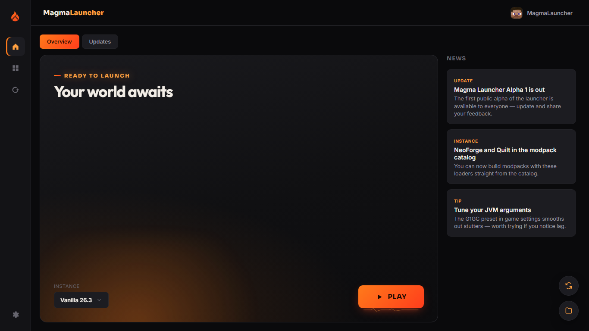
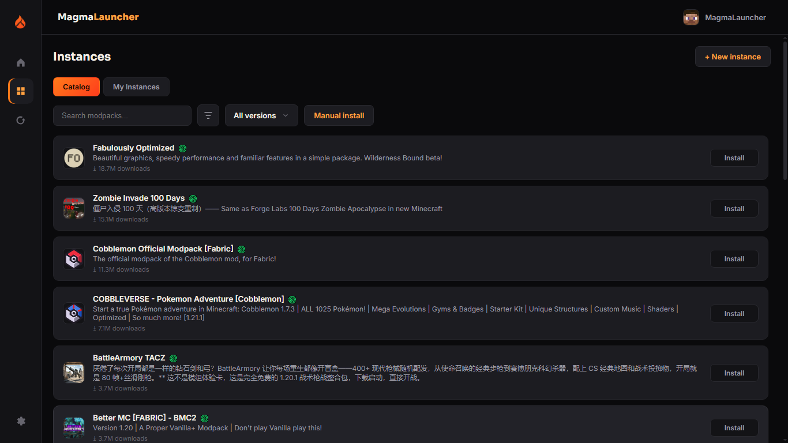
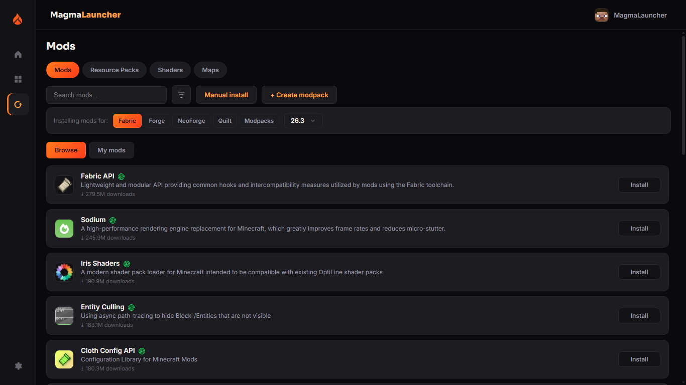
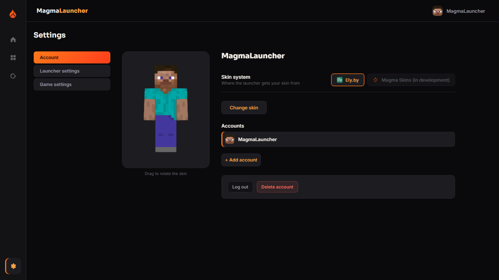

 <p align="center">
  
</p>

<h1 align="center">MagmaLauncher</h1>

<p align="center">
  An open-source Minecraft launcher built for modded gameplay.
</p>

<p align="center">
  <a href="https://github.com/Erz05506/MagmaLauncher/releases">Download</a>
  ·
  <a href="https://github.com/Erz05506/MagmaLauncher/issues">Report a bug</a>
  ·
  <a href="https://discord.gg/R7DCtQBYs">Discord</a>
</p>

<p align="center">
  
  
  
</p>

---

## About

MagmaLauncher is an unofficial, open-source launcher for **Minecraft: Java Edition**, built with C++ (CEF/Chromium) on the backend and HTML, CSS, and JavaScript on the frontend.

MagmaLauncher simplifies modded Minecraft setup by automatically downloading the required Java runtime, fetching game files and assets, and installing mod loaders and modpacks — without manually managing game folders.

## Screenshots

<!-- Add your actual launcher screenshots to assets/screenshots/ -->

### Home



### Instances



### Mods



### Settings



## Features

- **Multiple game versions and loaders:** Vanilla, Fabric, Forge, NeoForge, and Quilt support, with automatic Java version detection and download.
- **Mod management:** Browse mods, resource packs, shaders, and maps from Modrinth and CurseForge.
- **Modpack support:** Create modpacks and install existing `.mrpack` and CurseForge modpacks.
- **Multiple accounts:** Guest nicknames and Magma accounts with email/Google authentication through Supabase. Microsoft/Xbox login is planned.
- **3D skin previews:** Ely.by skin integration with a live 3D preview powered by skinview3d.
- **Discord Rich Presence:** Display your game activity on Discord.
- **Custom launch settings:** Configure JVM arguments, RAM allocation, and game or launcher directories.
- **Localization:** 12 interface languages.
- **Themes:** Multiple built-in color themes.
- **Privacy controls:** Telemetry blocking, streamer mode, launcher PIN lock, and automatic log cleanup.
- **Self-updating:** Check for new releases through a remote manifest and download updates.

## Tech Stack

- **Backend:** C++20, CMake, Ninja, MSVC, and [CEF](https://bitbucket.org/chromiumembedded/cef).
- **Frontend:** HTML, CSS, and JavaScript.
- **Networking:** libcurl.
- **JSON:** [nlohmann/json](https://github.com/nlohmann/json).
- **Authentication:** [Supabase](https://supabase.com/) for Magma accounts and [Ely.by](https://ely.by/) for skins.
- **Mod sources:** [Modrinth](https://modrinth.com/) and [CurseForge](https://www.curseforge.com/).

## Building from Source

### Requirements

- Windows
- Visual Studio with the MSVC C++ toolchain
- CMake
- Ninja
- [vcpkg](https://github.com/microsoft/vcpkg)
- [CEF binary distribution](https://cef-builds.spotifycdn.com/index.html)

### Setup

1. Clone the repository:

   ```bash
   git clone https://github.com/Erz05506/MagmaLauncher.git
   cd MagmaLauncher
   ```

2. Download the appropriate CEF binary distribution and place its contents in `backend/cef`.

3. Install the required dependencies using vcpkg:

   ```powershell
   vcpkg install curl:x64-windows nlohmann-json:x64-windows zlib:x64-windows
   ```

4. Configure the project. Replace the toolchain path if vcpkg is installed elsewhere:

   ```powershell
   cmake -S backend -B backend/build -G Ninja -DCMAKE_BUILD_TYPE=Release -DCMAKE_TOOLCHAIN_FILE=C:/vcpkg/scripts/buildsystems/vcpkg.cmake
   ```

5. Build the launcher:

   ```powershell
   cmake --build backend/build
   ```

## Project Status

MagmaLauncher is currently in **Alpha** and is under active development. Features, interfaces, and internal systems may change between releases.

Bug reports, suggestions, and contributions are welcome!

## Community & Links

- 💬 [Discord](https://discord.gg/R7DCtQBYs)
- ▶️ [YouTube](https://www.youtube.com/@Erz05)
- ✈️ [Telegram](https://t.me/magma_launcher)
- 🐛 [Report a bug](https://github.com/Erz05506/MagmaLauncher/issues)
- 📦 [Releases](https://github.com/Erz05506/MagmaLauncher/releases)
- ❤️ [Support the project](https://www.donationalerts.com/r/erzz05)

## License

MagmaLauncher is released under the [MIT License](LICENSE).
